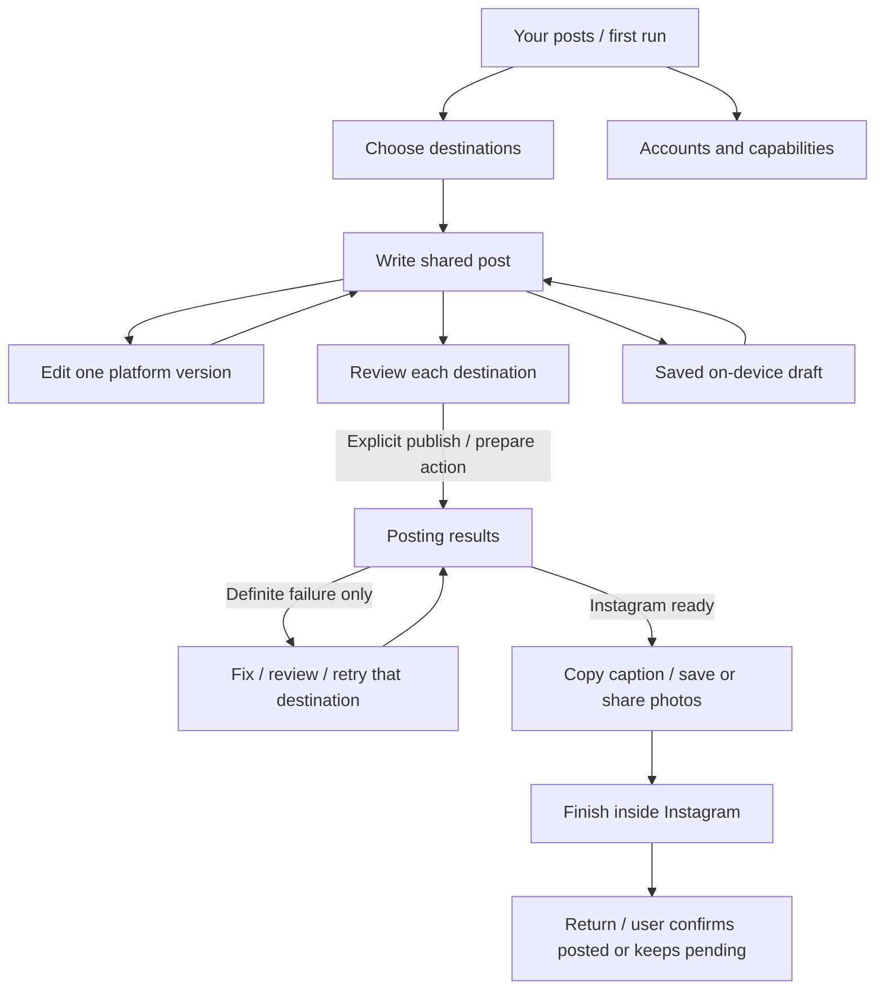

# Personal cross-posting app — design for review

**16 November 2026 · Design only · Proposed MVP**

**Visual status update:** the initial Soft Plum and Clear Blue treatments were rejected as too generic. The journey, scope and behavior in this brief remain applicable. The palette and initial screen styling in section 7 are historical proposals, not an approved visual system. Current alternatives are [Dispatch and Margin](options-v2/README.md); both await the user's choice.

An Android-first, human-operated app for writing once, adapting when necessary, and knowing exactly what happened at each destination. Flutter is the provisional framework. Installation and account connection should be enough to get started; the user should not have to run a server.

The selected experience is **Choose → write → review**, followed by individual publishing results and an assisted Instagram finish. This document and the accompanying static drawings are the review deliverable. They are not an app, a working prototype, an implementation plan, or evidence that an integration works.

## 1. Product brief

**Audience and scene.** An individual on their Android phone sharing a thought, a few photos, or a video to their own accounts. They may be interrupted, switch apps, lose connectivity, or come back to a half-finished post. The interface serves an everyday task, not campaign management.

**Job.** Prepare one post; choose its destinations; adjust only what differs; send supported destinations; finish Instagram personally; leave with a truthful, recoverable record.

**Success.** The person can identify the destination accounts before sending, understand what remains manual, recover their work after an interruption, and resolve a failure without duplicating successful posts. These are design acceptance criteria, not measured outcomes.

**MVP scope**

- Android phone experience, designed around Flutter's native Android capabilities and Material 3 conventions.
- One connected account per direct-publishing platform as a proposed simplifying limit. X/Twitter and Bluesky use official authentication and posting paths only, subject to feasibility gates below.
- Shared text, ordered photos or a video, destination selection, independent platform versions, accessibility descriptions, and approximate previews.
- Locally saved drafts, owned copies of selected media, visible saving states, interrupted-work recovery, and a local record of posting attempts.
- Independent X and Bluesky results, explicit partial success, reconnecting, and retries limited to eligible destinations.
- Instagram personal accounts: prepare feed photos/carousels and a caption; share files through a tested supported handoff when available; always retain save-media/copy-caption instructions. The user publishes inside Instagram.
- First-run, empty, loading, validation, disconnected, offline, storage failure, uncertain publication, and recovery states.

**Explicit non-goals**

Scheduling, analytics, teams, approvals, agency workspaces, social feeds, engagement management, required AI, agent workflows, automatic Instagram publishing, Instagram video/Reels/Stories, a media-editing suite, cloud draft sync, multiple accounts per platform, and app-wide simultaneous publishing guarantees. No Postiz fork is assumed. There is no prototype, production app, backend, or live integration in this session.

**What is confirmed versus proposed**

| Confirmed by the user | Proposed for this review | Still unverified |
| --- | --- | --- |
| Android phone first; interest in Flutter | Android is the first release target; other platforms adapt later | Minimum supported Android version and distribution |
| Install/connect; on-device drafts; no server to manage | No app-specific login; local draft library | Official auth, registration, posting access and costs without a service we operate |
| Instagram personal account; assisted finish | No Instagram sign-in; optional local account reminder | Targeted file sharing and photo saving on actual devices |
| Instagram photos/carousels first | A photo set or one video per destination; no mixed-media editor initially | Provider-specific combinations, limits and processing |
| Choose → write → review | One account per platform; exact controls and visual tokens below | Device performance, accessibility and usability |

## 2. Journey and screen structure

**Your posts** is a small local library, not a dashboard. It has Drafts and Results tabs and a New post action. Results needing attention stay visible when the app reopens; the user can resume an Instagram finish without finding the original draft. Accounts is reachable from the top app bar. No bottom navigation is needed for two library tabs.

First run has a plain explanation: “Write once. Review each destination. Finish Instagram yourself.” Offer **Create a draft** and **Set up accounts**. Connecting is not required to write a draft. Ask for media access only when adding or saving media, using the narrowest supported system picker/export interaction.

**The focused posting flow** uses a top app bar, a labeled three-stage progress indicator, scrolling content, and one bottom action. System Back saves the current stage and returns naturally. The stage indicator permits returning to earlier stages; it is not the only navigation control. Drafts resume at their last stage, not at Choose every time.

| Screen | Main content | Primary next action |
| --- | --- | --- |
| Choose | Destination checkboxes, account identity, direct versus assisted capability | Continue to writing |
| Write | Shared text, ordered media, save status, platform-version rows | Review post |
| Platform version | This platform's text/media, inheritance status and validation | Done; return to Write |
| Review | Destination summaries and expandable previews; publication/preparation summary | Publish & prepare / Publish to [platform] / Prepare Instagram |
| Results | Independent status, evidence, and recovery action for each selected destination | Resolve the outstanding destination |
| Finish Instagram | Exact prepared revision, numbered photos, caption, fallback, confirmation | Copy/save/share; then user confirms |
| Accounts | Capabilities, official connection status, reconnect/disconnect | Connect or reconnect one account |
| Your posts | Local drafts and posting attempts; pending Instagram work | Resume or create a post |

For wider screens later, retain the journey and place the current editor beside a review pane. Do not promise desktop sharing from a phone-shaped UI. Future iOS work must separately respect iOS navigation, permissions, storage, and share behavior; Flutter does not make these identical.

## 3. Composer and review behavior

### Choose before writing

All three destinations can be selected independently. A row says **Publish from this app** for an officially supported, connected direct destination, or **Finish in Instagram** for assisted sharing. Show the connected handle for X and Bluesky. For Instagram say “Choose your account in Instagram”; a typed reminder is never a verified connection.

An unconnected destination can remain selected while drafting and carries “Connect before publishing.” Continue to writing remains available. Review identifies blocking destinations and offers Connect, Edit, or Deselect. Never silently omit a selected destination. If the person wants to send the valid ones, they explicitly choose those on review and see the updated summary.

New drafts begin with no destinations selected in the MVP proposal; the existing draft remembers its selection. Remembering previous destinations can be considered later, without making an accidental public destination the default.

### One shared source, explicit overrides

The shared composer has a persistent label, **Shared post**, and a hint: “Used by every selected destination unless you customize it.” Media is ordered and numbered. Each item supports replace, remove, description, and move earlier/later; dragging is optional, never the only reorder mechanism.

Platform-version rows read **Uses shared post**, **Customized**, or **Needs attention**. Tapping one opens a full editor rather than forcing long writing into a bottom sheet. Text and media inheritance are independent. Changing a platform's caption does not unnecessarily freeze its media list.

- Shared edits update fields that still use shared content.
- A customized field retains its exact content. Show “Shared post changed; this caption is unchanged” when relevant, with a comparison action.
- **Use shared caption/media** is explicit and confirms replacement when it would discard customized work. A one-step Undo follows.
- Deselecting a platform preserves its customized version in that draft; reselecting it restores the work and reruns validation. It does not publish to the deselected destination.

For the MVP, each destination gets a photo set **or** one video. A shared video with Instagram selected produces a scoped issue: “Instagram needs photos in this version. Add Instagram photos or remove Instagram.” It does not erase the video or block saving the draft. Per-platform media can use a separate photo set; there is no silent video-to-image conversion.

Media preparation preserves originals. Proposed basic image tools are reorder, replace, rotate, and an explicit crop when required. Show the original and expected crop; never silently crop a composition. Video trimming, transcoding and a general media editor are outside the design baseline; an unsupported video gets actionable requirements instead. Video publishing remains gated by actual provider support.

### Validation and previews

Validate per destination: connection, current text counting rules, attachment count/type, dimensions/aspect, file size, duration, and any mandatory fields. Limits come from a maintained provider capability definition verified before implementation. This design deliberately does not freeze changing numeric platform limits. A normal counter is quiet; near-limit and over-limit states name the destination and exact remedy.

No global “something went wrong.” Example: “Bluesky: this video is too long. Replace it for Bluesky or remove Bluesky.” A warning distinguishes uncertain presentation from a blocking incompatibility. Stale or unavailable validation says “Couldn't check current requirements”; it never becomes a green Ready state by default.

Previews are **content checks**, not exact replicas of social apps. Each shows destination/account, final text, all media in order, and any custom version. Label them “Approximate preview.” Mentions, links, crops, accessibility metadata and video handling may differ; unresolved differences are visible before publication. A platform's preview can expand to a full-screen view for long text, media or large font settings.

Review always separates **Publish now: X, Bluesky** from **Prepare only: Instagram**. The mixed-flow button reads **Publish & prepare**. Instagram-only reads **Prepare Instagram**; a direct-only action names the destination or number of accounts. Sending starts only here, following explicit user action; no stage transition publishes.

## 4. Publishing results and safe recovery

At confirmation, capture the exact reviewed content and destination set as a posting attempt. Each destination progresses independently. The results list uses a stable order and displays account identity, status, explanation, and the next available action.

| Status | Meaning and evidence | Available action |
| --- | --- | --- |
| Preparing | Local work or an upload has begun | Leave the screen; the attempt remains recoverable |
| Sending / processing | Work is in progress; publication is not yet confirmed | See progress; no second Send action |
| Published | Official response/status confirms a created post, with identifier/link where provided | View post; no Retry |
| Not published | A known rejection or failure before publication | Fix and retry this destination |
| Connection needed | Official connection is absent/expired | Reconnect, then review and retry this destination |
| Publication unknown | The app lost confirmation after a request may have been accepted | Check the account; do not offer ordinary Retry |

Do not treat upload success or provider processing as a published post. If connectivity is lost after sending, preserve **Publication unknown** until official reconciliation or a human check resolves it. If official reconciliation is unavailable, the user can record “I found the post,” separately labeled as a user report, or choose **I checked; send again** after a clear duplicate-risk explanation. A timeout alone never becomes a definite failure.

**Partial success example:** X is Published, Bluesky is Not published, Instagram is Ready to share. Show exactly that; there is no global green success screen. Retry Bluesky touches only Bluesky. If several destinations have definitive failures, **Retry failed destinations** names the eligible ones; pending, unknown, published, and assisted destinations are excluded.

Editing before retry affects only the failed destination's new attempt. Published snapshots remain immutable. To change an already-published version, create a new draft; remote editing or deletion is outside MVP. Retried requests must also be protected against accidental double taps and recoverable after process interruption, to the degree supported by official provider behavior.

Results remain usable offline. The app does not promise unattended background completion: if Android stops execution, reopening shows the last durable state and reconciles uncertain work before enabling another send. No automatic resend occurs on app launch or network return. A cancellable preparation step may stop before dispatch; a transmitted publication cannot be described as canceled just because the user leaves.

## 5. Assisted Instagram, explicitly manual

No Instagram credentials, OAuth connection, business conversion, unofficial API, or browser automation is part of this flow. **Enable assisted sharing** turns on local preparation, not account access. The person chooses the correct Instagram account and audience inside Instagram.

The prepared package contains the reviewed caption, numbered photos in the intended order, and any descriptions the user may need to enter manually. Each package belongs to a particular reviewed revision. Changing the draft requires **Prepare updated version**; it does not mutate files that may already have been handed off.

| State shown | What may set it | What it does not mean |
| --- | --- | --- |
| Preparing | Local media preparation is in progress | Files are ready or Instagram is open |
| Ready to share | The package is durably prepared and available | Anything was sent or posted |
| Handed off | A supported sharing request with the prepared files was dispatched to an identifiable Instagram target | Instagram imported every file or published anything |
| User marked as posted | The person explicitly confirms that they finished posting | The app verified publication |

**Opening Instagram alone does not advance Ready to share.** Opening the Android share chooser does not prove a handoff either. If the platform cannot identify the target or confirm dispatch, keep Ready to share and show “Sharing opened; completion unknown” as explanatory activity. A returned focus event never implies publication.

**Always-available practical path**

1. **Copy caption.** Show the full caption and an explicit Copy caption button; acknowledge a successful clipboard write. Never assume a share intent prefills captions. A failed copy leaves selectable text and a retry.
2. **Save photos.** Save the prepared images to a user-accessible location through supported Android facilities. Confirm each actual save, show the destination when known, and keep numbered thumbnails/order guidance. If only some save, say “1 of 2 saved” and retry missing files; do not claim the set is ready on the device.
3. **Open Instagram**, when launching it is supported and the app is available. Otherwise, “Open Instagram yourself.” Explain: create a feed post, select the saved photos in order, paste the caption, choose the intended account, finish any Instagram edits, and publish there. Gallery order is not assumed to match filename order.
4. On returning, ask through the screen **Finished posting?** Offer **I've posted it** and **Not yet**. Confirming presents a concise confirmation sheet: “Mark Instagram as posted? This records your confirmation; the app can't verify publication.” After confirmation, show **User marked as posted**, the confirmation time, and Undo. Pending work remains available in Results.

**Optional supported shortcut:** **Share photos to Instagram** is a convenience only after the actual device/format path passes feasibility checks. Copy caption remains separate and fallback actions stay available. Photo-set support, recipient selection, file order, target behavior, installation state, permissions and cancellation must all be checked. A single-photo path cannot be generalized to a carousel. If only one image is supported, do not pass only that image from a selected carousel without an explicit user choice.

Manual posting cannot be rolled back from this app. Undo on “User marked as posted” changes only the local record, returning to the prior pending state; the label makes this clear.

## 6. Drafts, storage and interruption

Saving feedback is precise: **Saving…**, **Saved on this device**, or **Couldn't save — keep this screen open**. An edit is not labeled saved until text, selection, overrides and media references are durably recorded. Selected source media is copied into app-managed draft storage so a temporary picker permission is not the only thing preserving it. Retain the original until the new copy is confirmed.

Draft recovery restores text, cursor/scroll where practical, destination selection, custom versions, ordered media, last stage, and any prepared Instagram package. A posting attempt and its confirmed results survive separately from an editable draft. On restart, resolve the durable attempt record before offering new publication actions.

When storage is full or a copy fails, identify the affected media. Do not replace good saved content with an incomplete revision or tell the person everything is saved. Provide Copy text and a clear retry while preserving the previous complete draft. Account disconnects never delete drafts. Draft deletion is local, with Undo; any related unresolved result remains available rather than disappearing silently.

On-device storage is not a cloud backup. Clearing app data, uninstalling, or losing the device may lose drafts. State this plainly in storage settings and first-run draft guidance, without nagging during ordinary writing. Optional export/backup is an open product decision; cross-device recovery is not promised by this MVP. No clipboard access, media-library scan or network action happens just to browse drafts.

## 7. Visual direction and reusable guidance

**Selected concept: personal correspondence, translated into a native task flow.** The sequence is recipient, message, receipt. The visual treatment takes warmth and quiet ink contrast from correspondence; the screens retain standard Android navigation and controls. There are no paper textures, handwriting, envelopes, postal decorations, or fabricated platform chrome.

The signature is the **destination status row**: the same account identity and aligned status/action structure appears in Choose, Review, Results, and the local library. A user can follow one destination through the whole task. Warm neutral surfaces support writing; plum marks current selection and the one primary action. Green, amber and red are reserved for semantic states and always paired with words/icons.

The static boards show an indicative 390 × 844 logical phone canvas. Segoe UI is a rendering stand-in in the drawings; the proposed Android implementation uses the Material type scale with Roboto/system sans. These are design concepts, not screenshots from Flutter or an emulator.

### Proposed semantic colors

| Role | Light | Dark | Use |
| --- | --- | --- | --- |
| Surface | `#FAF7F2` | `#1D1A20` | Reading and editing ground |
| Elevated surface/container | `#F0E9EC` | `#2B252E` | Quiet grouping and fields |
| On surface | `#312A35` | `#F2EAF1` | Main text |
| Secondary text | `#635B66` | `#C9BFCA` | Supporting labels |
| Primary | `#653B59` | `#E5B6D2` | Current step and primary action |
| On primary | `#FFFFFF` | `#3B2435` | Button text |
| Primary container | `#EBDDE4` | `#513B4A` | Selection |
| On primary container | `#4E2942` | `#F6DEED` | Selected labels |
| Outline | `#847986` | `#9C909F` | Meaningful boundaries and focus |
| Success text | `#28583F` | `#A4D7B5` | Confirmed completion, valid connection or successful validation; never unconfirmed publication |
| Warning text | `#735217` | `#EDCD88` | Needs attention / unconfirmed |
| Error text | `#A02C36` | `#FFB3B7` | Blocking error |

Bind roles to Material themes; do not scatter literal colors through future widgets. Dark mode follows the system and has its own role mapping. Wallpaper-derived dynamic color is deferred until the static schemes and state distinctions are tested; the proposed identity must never weaken contrast to preserve a hue.

**Type and spacing:** 16sp body, 14sp supporting text, 14sp button labels, 20–22sp screen titles, 28sp sparing section emphasis; regular and medium weights carry most of the UI. Use 4dp spacing increments, 20dp content gutters at the reference width, 16–24dp between groups, and at least 8dp between independent tap targets. Avoid headline typography in forms. Components use a small consistent radius family, standard Material elevations and no decorative shadows.

### Component and state contract

| Component | Rules and required states |
| --- | --- |
| Stage indicator | Labeled Choose / Write / Review; current stage also announced; completed stages may be revisited; no color-only progress |
| Destination row | Checkbox/selection, platform, account/capability, status text, one clear action; connected/disconnected/selected/error/loading |
| Shared field | Persistent label, selection/cursor, focused outline, helper/error association, saving separate from publishing |
| Media item | Number, thumbnail, description status, explicit reorder/remove; loading, missing, processing, invalid, ready |
| Version row | Shared/customized/needs attention, current platform and account; opens full editing page |
| Preview | Exact reviewed content/order plus approximate-presentation label; expand, loading, validation unavailable |
| Action button | Filled primary; outlined/text secondary; default, focus, pressed, disabled, busy; busy label names the operation |
| Result row | Stable destination order, status source, timestamp when useful, scoped action; never only a colored dot |
| Inline notice | Names the problem and remedy; persistent when action is needed; snackbar only for transient Copy/Save/Undo feedback |
| Instagram package | Revision, numbered files, caption, truthful progress, fallback and explicit manual confirmation |

Accessibility targets are WCAG 2.2 AA where applicable to native UI, Android TalkBack semantics, 48 × 48dp minimum touch targets, at least 4.5:1 normal-text contrast and 3:1 meaningful component boundaries. Test system text enlargement through 200% without truncating actions or instructions; layouts grow and scroll rather than shrink type. Test light/dark, keyboard-visible states, logical reading order, landscape, 320dp compact width, long handles, long translations and screen readers. Announce a result change once without repeatedly stealing focus. Errors link to the affected field. Do not make color, drag gestures, swipes or icon recognition the only path.

The bottom action respects keyboard and system-bar insets and never covers editable text. With the keyboard open, writing gets the space; scroll naturally and keep a reachable Review action without placing a large fixed tray over the editor. System Back first dismisses the keyboard. Motion is brief standard Material feedback, disabled/reduced with system settings; no celebratory animation for partial success.

## 8. Empty, loading and exceptional states

| Situation | User-facing treatment | Next action |
| --- | --- | --- |
| No accounts | “Start a draft now. Connect X or Bluesky before publishing. Instagram is finished in its own app.” | Create draft / Accounts |
| No drafts | “Your next post starts here.” One small explanation of local storage | New post |
| Empty Write | Persistent Shared post label and add-media action | Write or attach; Review explains missing content when relevant |
| No destinations | “Choose at least one destination.” | Select; do not enable Continue without one |
| Loading connection | Button names the provider; connection remains unverified | Cancel or return from official browser flow |
| Loading draft/media | Stable layout with per-item progress; text becomes usable when loaded | Wait/cancel importing affected item |
| Connection canceled/expired | Preserve all content; “Reconnect Bluesky to publish this version.” | Reconnect or deselect |
| Offline | “Offline. Your saved draft is available.” | Continue editing; publish only after connectivity returns and user confirms |
| Invalid destination version | Inline platform-specific error; other drafts/versions remain intact | Fix, replace media, or explicitly remove destination |
| Save failed | Persistent warning; last complete save remains intact | Copy text / free space / retry |
| Partial publication | Individual confirmed/failed/assisted rows | Retry eligible failures; finish Instagram |
| Confirmation lost | “Publication unknown. Check your account before sending again.” | Reconcile/check; explicit duplicate-risk decision if necessary |
| Instagram missing/no share target | Keep prepared package ready | Save media / copy caption / open manually on a suitable device |
| Instagram save partly failed | Accurate saved-item count and file list | Retry only missing exports |
| Returned from Instagram | Keep the prior pending status | I've posted it / Not yet |
| Previously prepared content edited | “This package uses an earlier version.” | Prepare updated version; preserve previous record |

## 9. Smallest feasibility checks before implementation

These are recommended future checks, **not performed in this design session**. Use current official documentation first, then narrow disposable device probes only when implementation is authorized. Do not build a backend or broad proof-of-concept to answer a smaller question.

| Priority / question | Smallest useful check | Pass evidence / consequence |
| --- | --- | --- |
| 1 — Can the desired install/connect experience exist? | Check current official X and Bluesky public/native-client authentication, app registration, callback, identity/client-metadata, token handling, permissions, posting access and pricing requirements. Separate developer setup from end-user setup. | Document whether an installable Flutter app can connect securely without a user-managed server or embedded client secret, and whether a developer-operated service or hosted metadata is required. Any required service, paid access or per-user developer setup returns to product review; do not silently introduce it. |
| 2 — Can each direct provider actually publish the MVP content? | With authorized test accounts later, publish one text post, one photo set and one supported video through official APIs; observe accepted/processing/published responses and limits. | A small capability matrix with exact verified limits, account requirements, identifiers and failure behavior. Unsupported video narrows that destination; no unofficial fallback. |
| 3 — Which Instagram shortcuts are reliable? | On the user's Android/Instagram version later, test one photo and a multi-photo set using official OS sharing, chosen target, URI grants/order, cancel/return, app absence, and caption handling separately. | Record exact combinations where dispatch is observable. Enable only tested shortcuts. If no reliable shortcut exists, ship the save/copy/manual-open design. |
| 4 — Does the fallback actually work? | Save two numbered prepared images through Android's supported export path, locate them from Instagram, select them in order, paste a copied caption, and finish manually. Test denied save and clipboard failure. | The user can complete a carousel without a direct handoff; actual save outcomes and locations are accurately reported. This path is a release requirement. |
| 5 — Can local recovery be trusted? | A focused Flutter/device probe later: select media, save, terminate/relaunch, revoke source access, interrupt preparation, simulate full storage and repeat taps. Inspect local recovery and token-storage options. | Saved content/media survive interruption; incomplete revisions never replace complete ones; tokens use OS-backed secure storage and are not included in draft exports/logs. |
| 6 — Can duplicates be prevented or made explicit? | Check provider idempotency/reconciliation capabilities and simulate a lost response after server acceptance in a disposable probe. | An uncertain attempt never turns into an ordinary failed-state Retry. If no programmatic reconciliation is possible, retain the human-check flow. |

Static metadata hosting and a running backend are different obligations. Neither is silently approved by “Flutter.” If official direct publishing cannot meet the desired setup, bring the concrete requirement and tradeoff back for review. Assisted Instagram already has its own viable fallback and should not be blocked by this decision.

## 10. Open decisions and review boundary

Before implementation: official provider access/cost and any operated-service requirement; supported Android versions; confirmed media limits; token storage and backup policy; open-source license/distribution; whether manual draft export belongs in the first release. One account per platform and the photo-set-or-video limit are proposed scope choices for review.

Later: iOS/web/desktop priority, cross-device backup/sync, additional account support, and Instagram video/Stories. None are implied by choosing Flutter. Product naming is intentionally open; the interface can use descriptive screen titles without inventing a brand.

For review, assess whether the guided sequence feels appropriately light, whether partial results are understandable without explanation, and whether Instagram's manual work feels manageable. Approving this design does not itself authorize implementation; the session stops at this deliverable.

## Static concept boards

- [01 — Choose, write, review](screens/01-compose-and-review.png)
- [02 — Results and Instagram](screens/02-results-and-instagram.png)
- [03 — Accounts, local recovery and platform edits](screens/03-supporting-screens.png)
- [04 — Empty, failure, uncertainty and manual-confirmation states](screens/04-state-guidance.png)

All accounts, media illustrations and result states are synthetic examples. Direct-publishing states illustrate the intended UX if official feasibility checks pass. No control in these drawings is interactive.

## Review checks performed

The static boards were opened and visually inspected. Missing icon glyphs and ambiguous preparation copy were corrected. Twenty selected foreground/background pairs were calculated in sRGB and met their specified 4.5:1 text or 3:1 boundary threshold; see `visual-checks.json`. These checks apply to the static artifact only. TalkBack, enlarged-text reflow, touch behavior, keyboard insets, native rendering, persistence and platform integrations require later implementation/device validation and have not been tested here.
