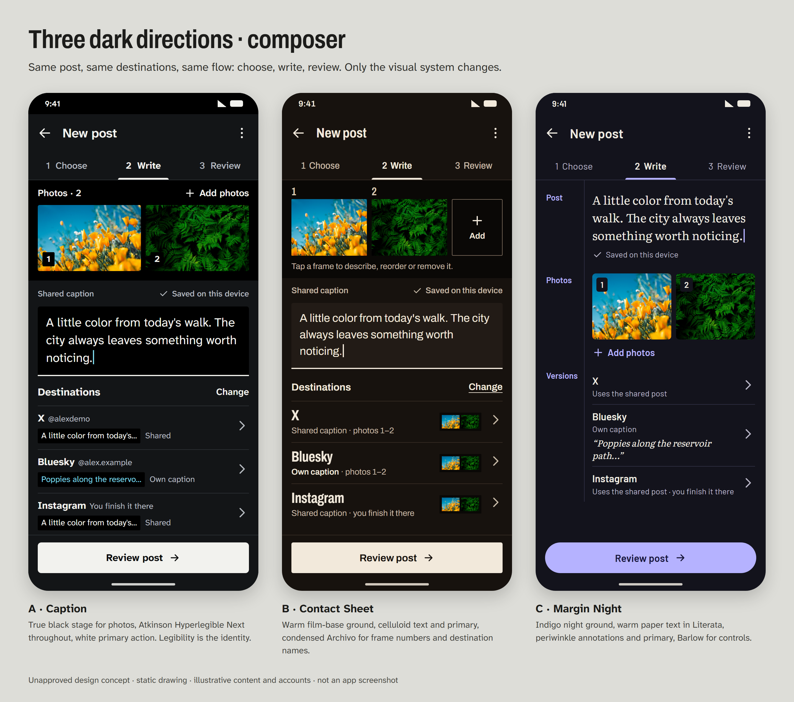
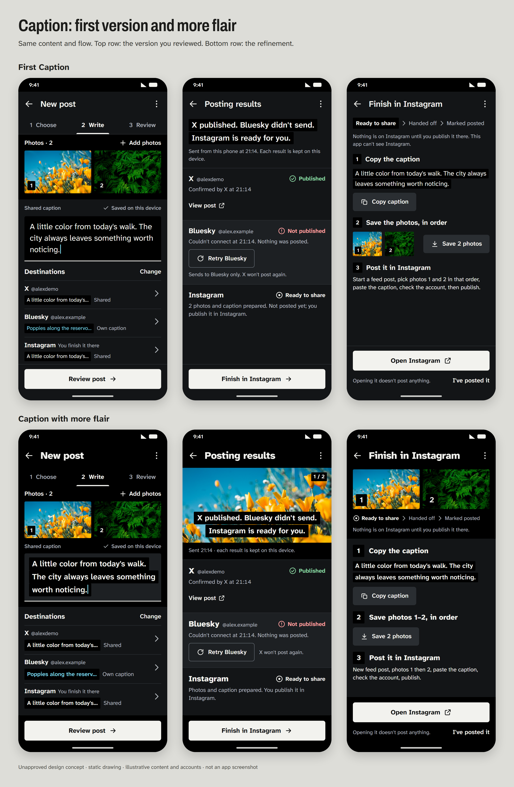

# Three dark-mode directions: Caption, Contact Sheet, Margin Night

16 November 2026. **Caption, with more flair (v2) is selected for further design refinement.** It is not an approved final visual system and does not authorize implementation. B and C remain unselected concepts.

These are static drawings of three new dark directions. Dispatch is excluded. The approved flow stays: Choose → Write → Review, then per-destination results and an assisted Instagram finish. Only the visual system changes. All accounts, photos, times and results are illustrative. Nothing here is a screenshot, a prototype, or evidence that an integration works.

Full boards: [A · Caption](a-caption-board.png) · [B · Contact Sheet](b-contact-board.png) · [C · Margin Night](c-margin-night-board.png)
Side-by-side, same content: [composer](compare-composer.png) · [results](compare-results.png) · [assisted Instagram](compare-instagram.png) · [comparison page](index.html)

## A · Caption

**Idea.** The post is a caption. Each destination row shows the actual words it will publish, set in a closed-caption box. White text means the destination uses the shared caption. Cyan means it has its own, like a caption's speaker colour. The word "Shared" or "Own caption" always sits beside the box, so the meaning never depends on colour alone. Photos sit on a true-black stage. Results open with a two-line caption-style summary. The Instagram state ladder marks the current state with the same caption box.

**Type and colour.** Atkinson Hyperlegible Next throughout, at four size steps. True black stage, near-black ground, white primary action, cyan reserved for own-caption text and the caret.

**Tradeoffs.** It is the plainest of the three: the caption samples and the type carry its character, with no ornament. It makes the riskiest concept, shared versus customized text, visible without opening anything. True black needs care: OLED smear when scrolling, and photos with black edges merge into the stage. Truncated caption samples need a full-text preview one tap away, which Review already provides.

## B · Contact Sheet

**Idea.** Photos lead as a strip of numbered frames on a dark film-base band. The frame numbers are the order Instagram needs. The same numbers appear in the composer, on the Instagram finish ("Pick them in this order"), and in each destination's row. Destination names are set large in condensed Archivo, like edge print.

**Type and colour.** Archivo for body text, condensed Archivo for frame numbers and names. Warm film-base ground, a darker rebate band, celluloid-cream text and primary. Colour comes from the photos and the state colours.

**Tradeoffs.** It is strongest for photo posts. Text-only posts lose the strip and look plainer. Its warm dark ground and cream are the nearest of the three to Dispatch's warmth, though it has no amber or connected rail. Destination thumbnails are small. They confirm that media is present and never carry meaning alone.

## C · Margin Night

**Idea.** Margin, evolved for dark rather than inverted. The post text is serif. The annotation gutter does more work than before: it labels Post, Photos and Versions in the composer; it holds each result's state icon and time; and it numbers the Instagram steps. A customized version shows its own caption excerpt in serif italic.

**Type and colour.** Literata for the user's words, Barlow for controls. Indigo-night ground, warm paper-white text, periwinkle annotations and primary.

**Tradeoffs.** Writing feels most personal here. The gutter costs about 90dp of width, so it must fold into inline labels at large font sizes and below about 360dp. Indigo and periwinkle sit closest to the rejected plum family. Serif styling stays local to the editor and does not format the published caption.

## Reusable guidance (for whichever direction is chosen)

| Area | Guidance |
| --- | --- |
| Typography | One UI family plus at most one voice face. Map to Material roles: post text = Body Large at 19–21sp, titles = Title Large 22sp, labels = Label Large 14–16sp. Nothing below 14sp. Use sp units and let text grow to 200%. Tabular numerals for times. |
| Colour | Snap surfaces to a fixed tonal ladder of 4–5 steps rather than ad-hoc greys. Reserve green, red and amber for semantic states, always paired with a word and an icon. Each direction's identity colour never means success, failure or warning. Define light-scheme equivalents before adoption; none exist yet. |
| Components | Standard Material components themed per direction: top app bar, tabs for the stage indicator, filled, tonal, outlined and text buttons, filled text field. One filled primary per screen, on the next action. No cards for list content; rows with hairlines. The destination row keeps the same slots on every screen: name, account, caption source, state, one action. |
| States | Published = confirmed by the provider, with a time. Not published = known failure; Retry names the one destination and says what will not repeat. Ready to share, Handed off and Marked posted are distinct labels, each with its own icon; Opening Instagram never advances them. Saving shows Saving…, Saved on this device, or Couldn't save. |
| Boundaries | Outlines and indicators must reach 3:1 against their ground. Tonal button fills are not boundaries; the label identifies them. |

## Recommendation

**A · Caption.** It is the only direction where the composer shows which words each destination will publish, without opening the version editor. Shared-versus-customized captions is the concept most likely to cause a wrong post. Caption makes it legible at a glance and pairs it with a face built for legibility. It also avoids C's width cost and B's dependence on photos. Its risk is plainness. If you want more character, B is the stronger alternative for photo-led posting.

## Checks performed and their limits

Every board and single screen was opened and visually inspected after rendering. One correction batch fixed three problems: a destination row hidden behind the composer's bottom bar, a clipped Instagram step, and a state ladder that read as tabs.

Contrast, static only. [`checks.json`](checks.json) records these ratios:

- **Text:** 192 text elements across the nine screens, computed from the rendered DOM's colours and backgrounds. All meet 4.5:1, or 3:1 for large text; the lowest is 8.35:1.
- **Boundaries:** 15 boundary and indicator pairs from the tokens. All meet 3:1; the lowest is 3.31:1.
- **Pixels:** 11 points sampled from the rendered PNGs. Each sampled background, measured against its text token, meets 4.5:1.

**Not tested:** native rendering, TalkBack, 200% font scaling, gutter collapse, keyboard insets, touch targets on a device, OLED behaviour, light schemes, and every integration capability. The drawings use a 390 × 844 logical canvas rendered in a browser, not Flutter or an emulator.

## Exploration record

Impeccable direction roll `seed:544fa50825b1ea33`, re-roll round 2 (previous candidates eliminated). Seven grounded candidates were ranked by resonance for an individual sharing their own photos and words: contact sheet, gallery wall label, self-published zine, broadcast captions, bookcloth and foil, setlist, photo-booth strip. The roll assigned candidate 4, broadcast captions, which became A. B is the top-ranked candidate, offered as the alternate. C is the dark evolution of Margin you explicitly allowed for.

The roll also dealt six catalog challengers. All six lost on both audience fit and product clarity. Each lent one discipline to A, written as a named raise:

- **Darkroom exposure record → tonal ladder:** surfaces snap to four steps: stage, ground, raised, raised-2.
- **Jet-age ticket wallet → nothing disappears:** every result carries its time; a retry adds a dated line rather than overwriting.
- **Orienteering map → one reserved course colour:** the white fill appears once per screen, on the next action.
- **Midnight transit diagram → focus the corridor:** the one destination that needs action is raised; the others stay quiet.
- **Bitmap type specimen → one family, strict steps:** Atkinson Hyperlegible Next at four sizes.
- **Character goods catalog → fixed furniture:** name, handle and caption sample sit in the same slots on every screen.

Impeccable's browser decision page was not used. You asked for static boards in this folder and one selection question, so those replace it. No direction contract or DESIGN.md has been written because nothing is approved.

## Files and provenance

- `src/` holds the generator (`build.py`), per-direction CSS, `render.sh` (headless Edge at 2x) and `checks.py`. These are authored static drawings, not AI-generated images.
- Fonts (SIL OFL, licence files in `assets/`): Atkinson Hyperlegible Next and Archivo from github.com/google/fonts (`ofl/atkinsonhyperlegiblenext`, `ofl/archivo`); Literata and Barlow reused from `../options-v2/assets/`.
- Photos: the same Unsplash samples used in earlier rounds; origins are in `assets/sources.json`. They are not the user's photos.

Choosing a direction selects it for further design refinement. It does not authorize implementation.

## Update: Caption, with more flair

You asked for Caption "with just a bit more flair." It remains an **unapproved concept**. The first Caption files are unchanged; the refinement is saved alongside them.

[Board](a-caption-v2-board.png) · screens: [composer](a-caption-v2-composer.png) · [results](a-caption-v2-results.png) · [Instagram](a-caption-v2-instagram.png)

It uses the same tokens, faces and flow, with no new colours, fonts or components. The caption signature is used at full strength:

- **Letterboxed screens.** The status bar, app bar, stage tabs and bottom action bar move to the true-black stage. Each screen reads as a framed picture, with the working list between the bars.
- **Subtitled caption editor.** The shared caption sits on the stage under the photos, each line in its own caption box. It is still one ordinary text field, with a label, a caret and a focused indicator line.
- **Subtitled results frame.** The post's first photo runs full-bleed, with the outcome subtitled over it: "X published. Bluesky didn't send. / Instagram is ready for you." The per-destination rows below are unchanged in meaning.
- **Stronger type.** Screen titles are 26sp extra-bold; destination names on results are extra-bold. Instagram steps are numbered caption cues; photos 1 and 2 sit in order on the stage, with the state ladder beneath.

**Added risks.**
- More black means more OLED smear when scrolling.
- Subtitles over the results photo need a scrim or fallback for very bright or busy images.
- Line-boxed editing text must behave as one continuous field for selection, the cursor and TalkBack. All three are untested.

**Checks.** All six rendered screens were inspected after rendering. One fix batch addressed two clipped rows, a wrapping state ladder and a mismatched gesture strip. All 71 text elements in v2 meet their threshold, with the lowest at 8.35:1. Every piece of text over the photo sits on its own caption box. The same untested limits apply as above.

## Caption's remaining screens

These are still an **unapproved concept**: static drawings with illustrative accounts. Choosing them does not authorize implementation. They reuse only Caption v2's tokens, faces and components. The files are in [caption/](caption/).

| Board | Screens |
| --- | --- |
| [Posting flow](caption/caption-flow-board.png) | [Choose](caption/caption-choose.png) · Write (the v2 composer) · [Bluesky version](caption/caption-version.png) · [Review](caption/caption-review.png) |
| [Library and accounts](caption/caption-library-board.png) | [First run](caption/caption-first-run.png) · [Your posts](caption/caption-library.png) · [Accounts](caption/caption-accounts.png) |
| [Publishing states](caption/caption-states-publishing-board.png) | [Connection needed](caption/caption-review-blocked.png) · [Offline](caption/caption-review-offline.png) · [Publication unknown](caption/caption-unknown.png) |
| [Finishing Instagram](caption/caption-states-instagram-board.png) | [Back from Instagram](caption/caption-returned.png) · [Confirm](caption/caption-confirm.png) · [Marked posted](caption/caption-marked.png) |

**How the system extends.**
- **Cyan always marks a destination's own caption.** It is used in the composer row, the segmented control, the Bluesky version field and the Review preview. White text in a black box always means the shared caption.
- **Subtitles carry the headline moment of each screen.** On first run they state the promise. On the library they show what needs you. On returning from Instagram they ask the question. On results they summarise the outcome. Every subtitle sits in its own box.
- **Each screen has one white action.** Blocked and offline Review screens show a disabled button with a plain reason above it. The library uses a white extended FAB instead of a bottom bar.
- **Review separates "Publish now" from "Prepare only".** The button says both: "Publish & prepare".
- **States follow the brief's tables.** Publication unknown has no ordinary Retry; it offers "Check Bluesky", "I found the post" and "Send again…". Opening Instagram leaves the status at Ready to share. "Mark as posted" goes through a dialog, is recorded as the user's confirmation at a stated time, and can be undone.

**Checks (static only).**
- All four boards were inspected after rendering. No clipping or overlap was found.
- One copy fix made "Status: still Ready to share" explicit after Instagram opens.
- A DOM contrast check covered 229 text elements on solid fills. All passed, with the lowest at 8.35:1.
- Excluded from the contrast check: the intentionally dimmed backdrop behind the dialog, and text on disabled buttons. WCAG exempts disabled controls; that text is #B6BBC0 on #2A2E32, about 7.1:1.

**Untested.** None of the following has been tested: TalkBack order, font scaling to 200%, the dialog's focus trap, the snackbar's timing and its Undo through accessibility services, OLED smear, real Android share and clipboard behaviour, and whether Instagram accepts a multi-photo handoff.
