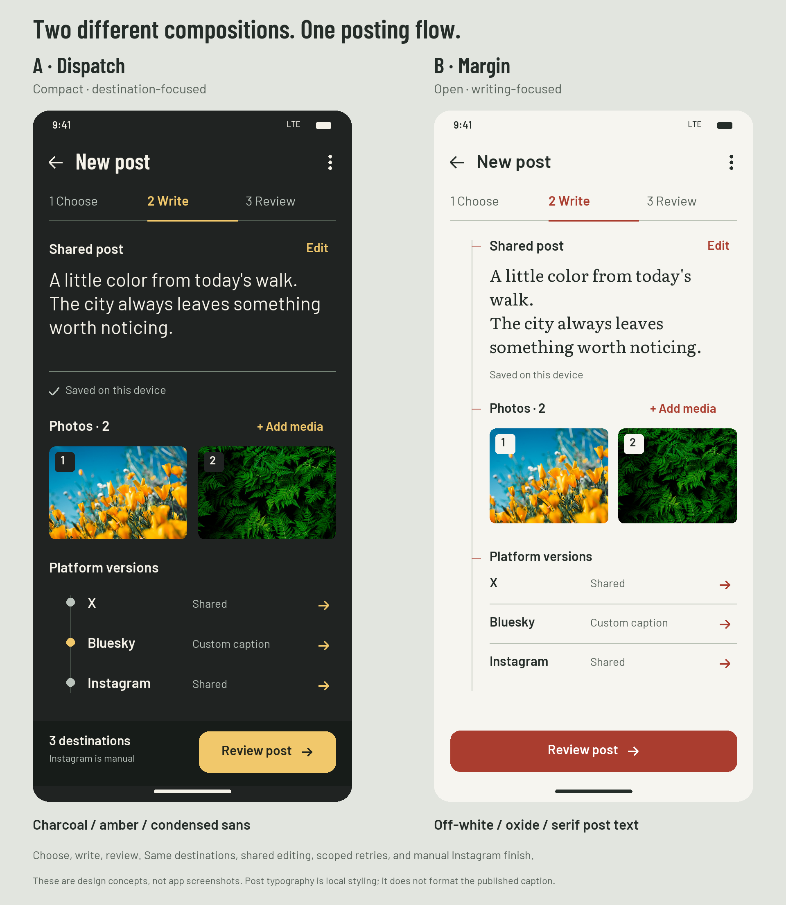

# Dispatch and Margin — revised visual directions

16 November 2026. **Awaiting selection. Design only.**

The previous pair changed color, corner shape and a few separators while preserving almost the same composition. The user rejected them as too generic. This round changes the reading hierarchy, typography, media scale, grouping and placement of the primary action, while retaining the agreed posting journey and behavior.

## A — Dispatch

A compact charcoal workspace with readable Barlow post text, condensed task headings, warm amber actions and a consistent destination rail. The rail joins each platform label to its version/status, carrying from the composer into results. The bottom action shares space with the selected-destination summary rather than becoming another full-width panel.

The Impeccable concourse reference contributed typographic clarity and stable destination alignment. Mechanical flaps, coded labels, live metrics and instrument-like decoration were excluded because they do not help this personal posting task. This remains an Android app with normal text editing, buttons and system navigation.

This direction feels like a focused personal utility. Its darker presentation suits lower-light use; a complete light scheme would be required before treating it as a product-wide choice. A dark mockup is not a commitment to dark-only UI.

[Composer, results and Instagram board](dispatch-board.png)

## B — Margin

An open writing surface with Literata for the user's post text and plain Barlow controls. A narrow annotation gutter groups shared content, photos and platform versions. The same gutter organizes the three practical Instagram steps. Results begin with the post's own image and excerpt, helping the person recognize the attempt they are returning to.

The Impeccable reference-setting direction contributed the association between writing and annotations. Its miniature type, multiple text columns, printed control metaphors and technical ruling apparatus were not carried into the app. Post text remains editable by tapping it or its Edit control; the gutter is not a new navigation mechanism. Serif styling is local to the editor and does not format the published caption.

This direction feels closer to a personal writing space. It uses more width for its gutter and must collapse that gutter at narrow widths or large system font sizes. A complete dark scheme would still be needed.

[Composer, results and Instagram board](margin-board.png)

## Preserved behavior

- Choose → write → review remains the main journey; no stage publishes before the explicit final action.
- Shared caption/media and independent platform edits retain their original semantics.
- Add media is next to the photos. Tapping a photo opens its media editor for description, reorder, replace and remove.
- X and Bluesky retain their individual results; retrying one cannot repeat a confirmed success.
- Instagram stays manual: ready, handed off and user marked as posted remain separate states. Open Instagram is never evidence of publication.
- Draft storage, recovery, account capabilities and all previously identified feasibility questions remain in scope.

These are static concepts, not a Flutter app or interactive prototype. The drawings show illustrative content, not tested account capabilities.

## Craft review and provenance

Six phone concepts, two option boards and one comparison were visually inspected. A correction batch removed missing arrow glyphs, moved Add media into the photo group, and differentiated the title hierarchy. Sixteen sampled foreground/background pairs met their normal-text or boundary contrast target. The actual controls still require native device, large-text, keyboard, touch and TalkBack testing later; the drawings do not establish those properties.

Barlow, Barlow Condensed and Literata are from the Google Fonts repository, with their OFL files retained in `assets/`. Their font source directories are:

- https://github.com/google/fonts/tree/main/ofl/barlow
- https://github.com/google/fonts/tree/main/ofl/barlowcondensed
- https://github.com/google/fonts/tree/main/ofl/literata

Sample media is reused equally across both options; exact origins are in `../options/assets/sources.json`. Photos belong to neither the user nor a demonstrated posting account. Preview crops do not imply cropping the user's originals.

Impeccable exploration reference: `seed:544fa50825b1ea33`, revised direction round. The retained visual references are `signals-instruments-split-flap-concourse` and `rw-centre-rail-reference-setting`. The other catalog suggestions were unsuitable for this brief: the warm consumer-card option repeated the rejected treatment; the dance-notation and encoded music-catalog options obscured task/status language; and a streaming-catalog wall overemphasized media for a shared writing task. No unselected reference constitutes design approval.

Choosing a direction selects an approach for further design refinement. It does not authorize implementation.
