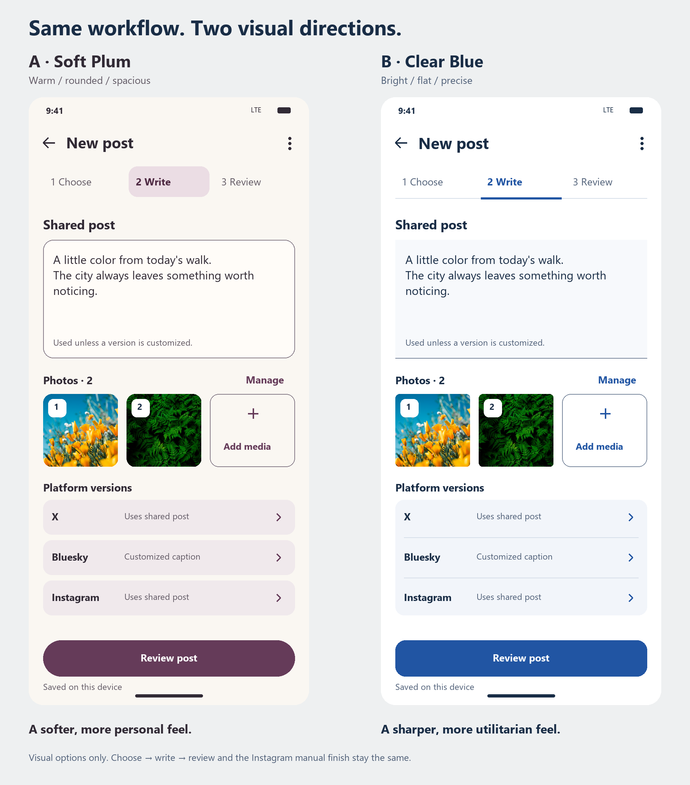

# Two visual options — same posting flow

16 November 2026. **Superseded: the user rejected these two visual treatments as too generic.** The guided flow and behavioral requirements are retained. The next visual exploration is in `../options-v2/`. These files remain as historical references and carry no visual approval.

Both options retain Choose → write → review, shared content and explicit platform overrides, local draft recovery, per-destination results, scoped retries, and Instagram's assisted finish. The same content and actions appear in both sets of mockups for a fair comparison. No app, prototype, backend, or live integration has been built.

| | A — Soft Plum | B — Clear Blue |
| --- | --- | --- |
| Character | Warm, gentle, personal | Bright, precise, utilitarian |
| Surface | Warm off-white with plum tonal groups | White with pale blue state areas |
| Grouping | Separate rounded panels | Shared lists and fine separators |
| Progress | Rounded current-stage fill | Current-stage underline |
| Writing field | Rounded outlined field | Filled field with bottom rule |
| Main actions | Plum pill-shaped buttons | Blue rounded-rectangle buttons |
| What to consider | May feel too soft for someone who wants a plain utility | May feel less personal than the warmer treatment |

- [Soft Plum: composer, results, Instagram](soft-plum-board.png)
- [Clear Blue: composer, results, Instagram](clear-blue-board.png)

The sampled light-theme text and boundary pairs met their contrast targets. Both retain explicit status words and usable-sized action areas in the static drawing. Neither has been tested as native UI, with TalkBack, enlarged text, keyboard insets, or real integrations. The winning visual treatment would also need its corresponding dark scheme before implementation.

The images are static authored drawings at twice a 390 × 844 logical phone canvas. Segoe UI stands in for Android's system sans. Photos are illustrative samples sourced from the public Unsplash CDN; their exact origins are recorded in [assets/sources.json](assets/sources.json). These are not the user's photos or posts. Thumbnail crops are illustrative, not an instruction to crop uploaded originals.

Choosing an option selects its visual direction. It does not authorize implementation or change the previously agreed product scope.
